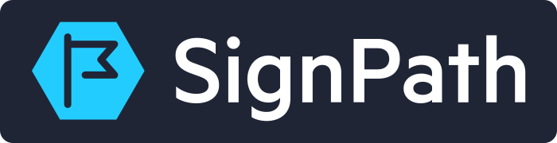

# Vibepollo

## What is Vibepollo?

Vibepollo is an AI‑enhanced version of Apollo, a popular remote streaming application. It intends to integrate all scripts from myself (Nonary) and more.


## Key Features

* **Display Setting Automation**
  Vibepollo adds multiple safeguards to prevent dummy plugs or virtual displays from getting “stuck” when you return to your PC. It resolves common Windows 11 **24H2** display issues and restores your layout after hard crashes, shutdowns, or reboots. (The only scenario it can’t restore is during a user logout.) The workflow is simplified to a dropdown—just pick the display you want to stream.

* **Windows Graphics Capture in Service Mode**
  Running Windows Graphics Capture (WGC) as a service improves performance and stability. It captures the full frame rate of frame‑generated titles, avoids crashes when VRAM is exceeded, and follows Microsoft’s recommended capture method going forward. Vibepollo auto‑switches capture methods on demand, so the login screen and UAC prompts are still captured even when using WGC.

* **Native Virtualized Display**
  Vibepollo uses its bundled virtual display driver by default and keeps SudoVDA installed as a rollback option. It can capture output from any GPU, including those in hybrid laptops, ensuring the virtual screen connects to the correct GPU when needed. It also provides simple virtual display options, allowing users to choose between a physical or virtual display. On headless setups, it enables automatically to prevent 503 errors and false encoder detections, such as incorrect HEVC support reports. Up to eight clients can each have their own virtual screen (`virtual_display_max_clients`, default four), and the dashboard detects and recovers orphaned virtual screens, including when physical monitors wake or return.

* **Remote Monitor and Remote Input**
  Launch **Remote Monitor** from Moonlight on another device to turn it into an additional, independently streamed display beside your main session. **Remote Input** attaches a client for control without video. Remote Monitor entries can have their own settings, and on Windows you can save how client displays are arranged relative to each other under **Devices → Arrange client displays**.

* **VRR Capture**
  With Nonary's [VRR Moonlight Client fork](https://github.com/Nonary/moonlight-qt), Windows automatically switches the virtual display to a fixed 1000 Hz mode so newly presented game frames are captured promptly without raising the stream frame rate. Linux virtual displays use presentation-driven capture for the same effect.

* **PyroWave Codec**
  PyroWave is a GPU wavelet codec with very low encode and decode latency on Windows and Linux. Frames are independent, so a lost frame never forces a new keyframe, and it supports SDR/HDR, 8/10-bit, and 4:2:0/4:4:4 where the GPU allows. It needs a fast **wired LAN** and the [VRR Moonlight Client fork](https://github.com/Nonary/moonlight-qt); Vibepollo can calibrate the link with paced UDP probes and adapts FEC to the available bandwidth. See the [PyroWave guide](docs/pyrowave-protocol.md).

* **Virtual Gamepad Driver (Windows)**
  Vibepollo ships its own free virtual gamepad driver—no ViGEmBus and no license key. It emulates Xbox Series, Xbox One, DualSense, DualShock 4, and Switch Pro controllers with rumble, impulse triggers, touchpad, motion, battery, lightbar, and DualSense adaptive triggers where the client and game support them. Optional wired USB DualSense emulation delivers native waveform haptics to compatible games, with an adjustable `dualsense_haptics_gain`. See [DualSense haptics setup](docs/windows-dualsense-haptics.md).

* **Focused Configuration Interface**
  Vibepollo includes a responsive, dependency-light browser interface built around the tasks people perform most often: selecting a streaming display, tuning frame pacing, managing games and devices, checking sessions, and recovering the host. The Everyday page groups display, smoothness, PyroWave, Remote Monitor, and game-library setup, while less common controls remain organized by domain.

* **Game Library Sync (Playnite, Steam, Lutris)**
  Deep integration with Playnite (a “launcher of launchers”) automatically syncs your recently played games with configurable expiration rules, per‑category sync, and exclusions, through a compiled Playnite plugin. Steam and Lutris libraries sync the same way, with artwork and recent-game policies. You can also add games manually from a Web UI dropdown; Vibepollo handles artwork, launching, focusing the game window, and clean termination—emulators included. The goal is a seamless, GeForce Experience–style library experience—only better.

* **RTSS & NVIDIA Control Panel Integration**
  Vibepollo can manage RTSS to apply the correct frame limit and disable V‑Sync before streaming, significantly improving frame pacing and smoothness. The applied frame cap matches the client device’s requested FPS.

* **Frame‑Generated Capture Fixes**
  DLSS/FSR game-provided frame generation requires Vibepollo's virtual screen for reliable capture. The virtual display guarantees composed flip, allowing generated frames to be captured through WGC, and Vibepollo targets 4x virtual refresh for pacing.

* **Lossless Scaling & NVIDIA Smooth Motion**
  Vibepollo can automatically apply optimal Lossless Scaling settings to generate frames for any application. On RTX 40‑series and newer GPUs, you can optionally enable **NVIDIA Smooth Motion** for better performance and image quality (while Lossless Scaling remains more customizable).

* **API Token Management**
  Access tokens can be tightly scoped—down to specific methods—so external scripts don’t need full administrative rights. This improves security while keeping automation flexible.

* **Session‑Based Authentication**
  The sign‑in flow supports password managers and includes a “remember me” option to minimize prompts. The experience is security‑hardened without sacrificing convenience.

* **Update Notifications**
  Built‑in notifications let you know when new features or bug fixes are available, making it easy to stay current. Prerelease notifications are on by default; you can switch to stable-only.

For PyroWave, VRR pacing, and DualSense waveform haptics, use Nonary's [VRR Moonlight Client fork](https://github.com/Nonary/moonlight-qt). Standard Moonlight clients still work for regular H.264, HEVC, and AV1 streaming.

Due to the sheer pace and volume of changes I was producing, it became impractical to manage them within the original Sunshine repository. The review process simply couldn’t keep up with the rate of development, and large feature sets were piling up without a clear path to integration. To ensure the work remained organized, maintainable, and actively progressing, I established Vibepollo as a standalone fork.

At this point, Vibepollo differs substantially from upstream Sunshine. At that scale, asking upstream maintainers to accept large backports in one sweep is generally not sustainable, which is why Vibepollo continues as a standalone fork.

---

## Linux (beta)

Vibepollo now runs natively on Linux as a set of machine-wide system services with its own
virtual-display kernel driver. The beta targets **Arch Linux and CachyOS**, and it is developed and
tested on **CachyOS with KDE Plasma 6 on Wayland**. You need Linux 6.16 or newer with matching
kernel headers, a Plasma Wayland session started by SDDM or Plasma Login Manager, and a GPU with a
hardware H.264 encoder. Testing has focused on NVIDIA and modern AMD GPUs; older cards may not work
properly. NVIDIA hosts can stream and pair from the login screen; AMD and Intel hosts start
streaming after desktop login.

Managed private virtual displays support HDR, GPU-resident capture, and Remote Monitor sessions
without dummy plugs. Linux also supports PyroWave (except on the NvFBC capture path), Steam and
Lutris library sync, Steam Big Picture, Proton-aware frame limiting and HDR compatibility, NVIDIA
Smooth Motion, DualShock 4 emulation, and wireless DualSense haptics and adaptive triggers when the
client also runs Linux. See [Linux PyroWave](docs/linux/pyrowave.md),
[PlayStation controllers](docs/linux/playstation-controllers.md), and
[Steam Big Picture](docs/linux/steam-big-picture.md).

```bash
curl -fsSLO https://raw.githubusercontent.com/Nonary/Vibepollo/master/scripts/linux_install.sh
sudo bash linux_install.sh
```

The script checks the requirements, installs the kernel headers and the package, opens the firewall,
and prints whether a reboot is needed. Reboot after the first installation, and approve Secure Boot
key enrollment if prompted. Updates come through a signed pacman repository with a DKMS display
driver. Manual steps, verification, and troubleshooting are in the
[Linux install guide](docs/linux/install.md). AppImage, Flatpak, Debian, Fedora, and Docker builds
are not part of this beta.

SteamOS development uses a separate [user bundle](packaging/linux/steamos/README.md)
which leaves the read-only operating system untouched. Its experimental Gaming
Mode path supports stock Gamescope SDR capture and an optional
[patched Gamescope HDR10 path](packaging/linux/steamos/gamescope/README.md).
Gaming Mode automatically uses the existing Gamescope output even when virtual
display is selected. Desktop display/layout preferences are preserved for the
next Desktop Mode session; Gaming Mode does not create independent monitors.
See the [SteamOS audit](packaging/linux/steamos/AUDIT.md)
for validation and remaining work.

## Does Vibepollo aim to replace Sunshine or Apollo?

Yes. Vibepollo replaces Sunshine or Apollo as your streaming host. On Linux,
use one host installation at a time: replace an existing Sunshine, Vibeshine,
or Vibepollo installation when installing Vibepollo, and preserve your
configuration and pairing data during the transition.


## Will Vibepollo’s features merge back into Sunshine or Apollo?

**Short answer: Unlikely to be backported upstream as large, sweeping merges.**

Vibepollo is largely AI‑generated. While it works well, it carries a kind of surface‑level technical debt that many upstream projects want resolved before taking big changes (styling consistency, thin/missing docs, and some over‑engineering). I see that debt as relatively unimportant today because modern AI tools can answer “why does this function exist?”, “what does this parameter do?”, or “how do these classes interact?” and will soon auto‑fix these issues—re‑style trees, write docstrings, and prune unused layers—without human effort.

So this “mess” is mostly cosmetic. It doesn’t break the code, create security risks, or block future maintenance. The only debt that truly matters is architectural: API design, threading models, modularity, and performance. Those are hard to fix even with AI tools, which is why I focus on them up front and guide the AI accordingly.

Because I define the architecture, I know how everything works. Whether the code looks polished or not doesn’t matter to me.

Bringing Vibepollo fully in line with upstream style and documentation would take a lot of engineering time for limited practical gain. For now, full backports into Sunshine or Apollo are unlikely. Over time, targeted refactors or added documentation may make **selective upstreaming** possible.

---

## Origin of the Name "Vibepollo"

The name arose as a playful suggestion from another developer who joked about the potential unmanageability of extensive AI‑generated code. Given that approximately **99% of Vibepollo’s code is AI‑generated**, the name seemed fitting.

---

## Why Use AI‑generated Code? Concerns About Technical Debt?

AI significantly accelerates development by offloading much of the routine implementation work. Instead of spending hours writing boilerplate, wiring dependencies, or handling repetitive edge cases, I can focus on high‑level architecture, long‑term design decisions, and system direction. This shift doesn’t just speed things up—it fundamentally changes the role of the engineer, pushing us toward oversight, orchestration, and design rather than rote code production.

What stands out most is how reliably AI code now works on the first try. When I started Vibepollo, it worked about 90% of the time; today's models are far more effective than that. That reliability, combined with instant generation, makes it dramatically more efficient to accept its form of debt than to painstakingly write everything from scratch. In other words, I’m trading minor, manageable debt for massive development velocity—and that trade is almost always worth it.

I’m not overly concerned about technical debt in this workflow, because the debt that truly matters stems from bad architecture and poor design choices, not from the code itself. As long as I guide the AI with clear structure and intent, the generated code ends up being maintainable. Problems like inconsistent naming, redundant code, or unused helpers are minor forms of debt—easily identified, cleaned up, or ignored. By contrast, deep architectural flaws, poor layering, or mismatched abstractions create lasting problems.

In fact, compared to many traditional enterprise codebases I’ve maintained, AI‑assisted code often comes out cleaner and easier to manage. Legacy systems are usually burdened with years of ad‑hoc patches, inconsistent styles, and various bad practices due to knowledge level of contributor. AI‑generated code doesn’t necessarily carry fewer design flaws than human code, but it does avoid accumulating those scars—especially when paired with an intentional architectural vision, and it is less likely to do seriously bad practices that you typically find in enterprise codebases.

Broadly speaking, AI‑assisted development represents the future of software engineering. Just as compilers and IDEs once transformed programming, AI is now transforming how we design, implement, and maintain systems. Instead of fearing it, I view it as a force multiplier that complements professional judgment. Vibepollo is an example of what happens when you embrace that shift: rapid iteration, a massive expansion of features, and code that remains maintainable because the architecture is intentionally guided.

That shift is no longer hypothetical. Major companies are now rebuilding core products with AI: Epic Games [rebuilt the Epic Games Store launcher from scratch with AI](https://www.pcgamer.com/software/platforms/epic-says-its-new-vibe-coded-epic-games-store-launcher-is-faster-than-steam/), and Shopify [moved its mobile apps off React Native to native Swift and Kotlin](https://shopify.engineering/back-to-native) because coding agents made building each platform separately affordable. Game preservation and emulation, some of the hardest reverse‑engineering work around, are progressing at an exponential pace: the [Super Smash Bros. Melee decompilation](https://www.androidauthority.com/super-smash-bros-melee-decompiled-3708716/) reached 100% after AI closed out the final stretch of a six‑year effort, the N64 game [Snowboard Kids was fully decompiled in 84 days](https://zeli.app/story/49466006) with AI agents (its sequel took 596 days without them), the fan‑made [Lost Odyssey static recompilation](https://www.xda-developers.com/i-waited-nearly-20-years-for-lost-odyssey-to-come-to-pc-and-it-finally-happened/) brought the Xbox 360 exclusive to PC with AI‑assisted development, and the open‑source PS5 translation layer [AnyPS5](https://hothardware.com/news/anyps5-hits-100-gpu-shader-coverage-for-playing-ps5-games-on-pc) reached full GPU shader instruction coverage with the help of AI‑generated code. It's clear that AI will be used in every software project from here on.

---

## The Original “AI-Only” Goal (And Why It Changed)

One of the original goals of Vibepollo was to prove a specific point: that an experienced developer could maintain a complex project using almost entirely AI‑generated code, as long as they provided the architecture and kept the system coherent.

That idea hasn’t aged particularly well, not because it was wrong, but because the models scaled far faster than most projections. The result is that the “skill gap” in prompting and guiding the AI matters far less than it did when Vibepollo started. You still need engineering judgment and architecture, but it’s now dramatically easier to get high‑quality, end‑to‑end results without the same level of careful orchestration. So the original “prove it’s possible” goal is basically moot: it’s not a niche workflow anymore, it’s simply where the tools have gone.

---

## AI Models Used by Vibepollo

Vibepollo has always been built with **Codex** as the primary workflow, and in practice that has meant mostly the **GPT family** (today: **GPT‑6.1**). I use it with the same principles as before: start from architecture, sanity‑check assumptions, and do the hard reasoning up front so the implementation lands cleanly.

I mostly reach for GPT because it's usually faster and more precise for the way I work. I occasionally use **Claude Opus 5.5**, but rarely.

Honestly, the choice of model doesn't matter much anymore. Current‑generation AI is good enough for 99% of software engineering tasks, so whichever capable model you prefer will get the job done.

---

## Sponsors

<p align="center">
  <a href="https://signpath.io?utm_source=foundation&amp;utm_medium=github&amp;utm_campaign=vibepollo">
    
  </a>
</p>

Thank you to [SignPath.io](https://signpath.io?utm_source=foundation&utm_medium=github&utm_campaign=vibepollo)
and the [SignPath Foundation](https://signpath.org?utm_source=foundation&utm_medium=github&utm_campaign=vibepollo)
for sponsoring Vibepollo's Windows code signing.

### Code signing policy

Official Vibepollo Windows releases use free code signing provided by
[SignPath.io](https://signpath.io?utm_source=foundation&utm_medium=github&utm_campaign=vibepollo), and a
certificate by the [SignPath Foundation](https://signpath.org?utm_source=foundation&utm_medium=github&utm_campaign=vibepollo).

* **Committer and reviewer:** [Nonary](https://github.com/Nonary)
* **Approver:** [Nonary](https://github.com/Nonary)
* **Privacy:** Vibepollo transfers information to networked systems only for functionality requested by the user or
  operator; it does not transmit user or runtime data to SignPath. Separately, SignPath's GitHub integration receives
  the build artifacts, signing-request details, and GitHub-provided build-origin metadata needed to sign official
  releases.
